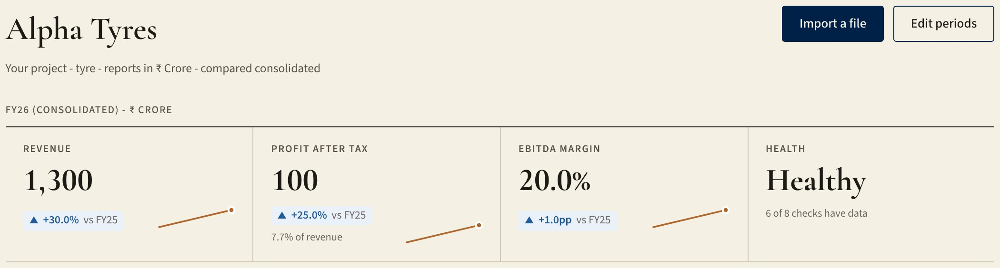
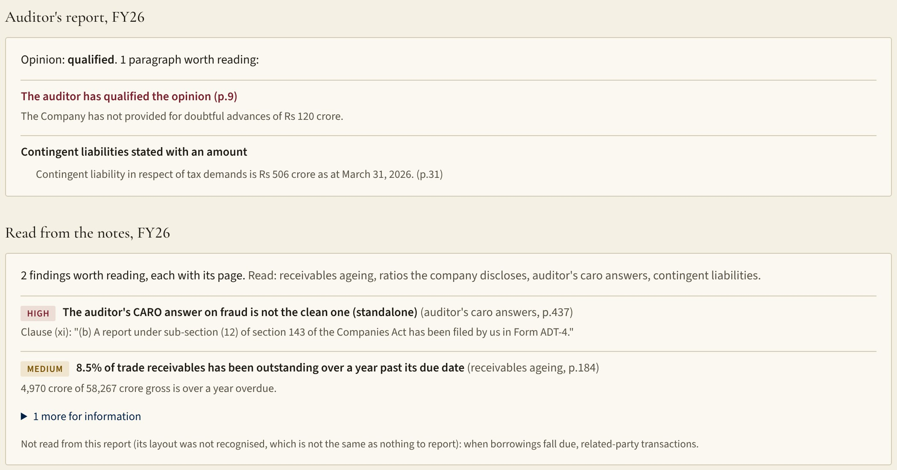
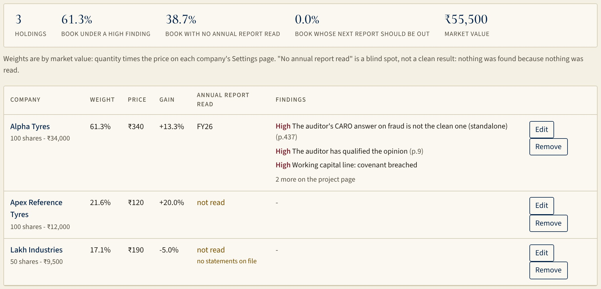
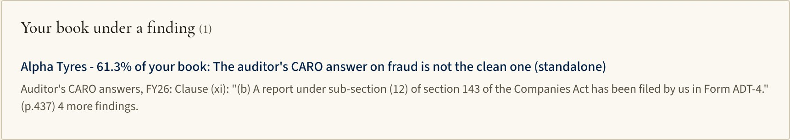
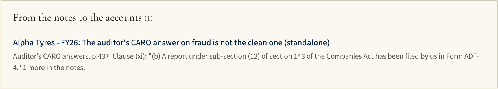
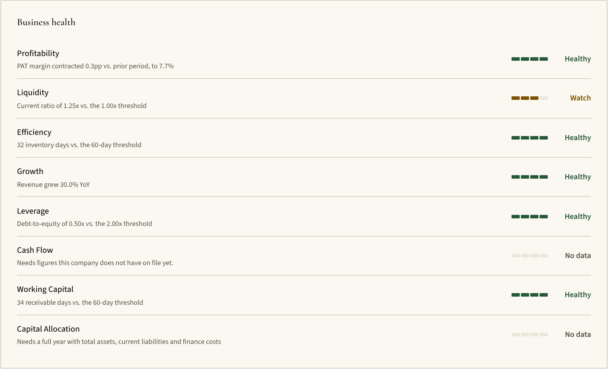
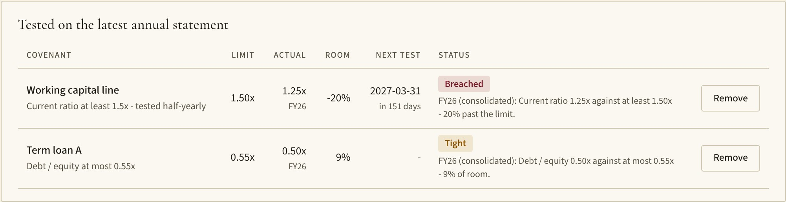
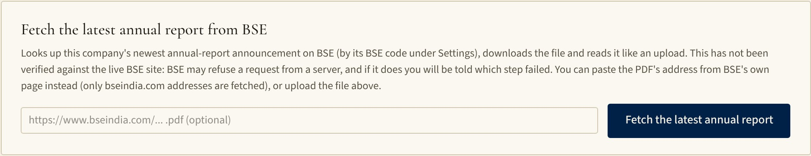

# Sentinel

**A forensic reader for Indian financial statements. It reads the notes nobody reads, and shows its work.**

Sentinel reads an annual report the way a forensic analyst would: the auditor's statutory answers, the receivables ageing, related-party transactions, contingent liabilities and when borrowings fall due. Each finding comes back with **the page it came from and the words as printed**, and every number is checked in code. A number that cannot be checked is dropped, never repaired. "Not read" is reported separately from "clean".

> This repository also holds other Zyntask pages. This README covers Sentinel: `app/sentinel/` (screens and logic), `app/api/sentinel/` (server routes), `supabase/migrations/` (database), `tests/sentinel/` (tests), `docs/` (design, evidence, protocols).

A designed, send-ready overview is in [`docs/Sentinel-overview.pdf`](docs/Sentinel-overview.pdf) (7 pages, A4).

---

## Contents

1. [Who it is for](#who-it-is-for)
2. [Status at a glance](#status-at-a-glance)
3. [What it does](#what-it-does)
4. [Feature reference](#feature-reference)
5. [The six notes it reads](#the-six-notes-it-reads) (with the CARO clauses and thresholds)
6. [From one company to your book (portfolio)](#from-one-company-to-your-book-portfolio)
7. [How it is different](#how-it-is-different)
8. [Evidence, and its limits](#evidence-and-its-limits)
9. [Screens](#screens)
10. [Brand and design tokens](#brand-and-design-tokens)
11. [Architecture](#architecture)
12. [Running it, testing it](#running-it-testing-it)
13. [Database migrations](#database-migrations)
14. [Documents in this repo](#documents-in-this-repo)
15. [What is next](#what-is-next)

---

## Who it is for

- **First: credit analysts at banks and NBFCs** appraising borrowers. Most borrowers are unlisted, so no database covers them. The borrower or their CA sends the file (PDF, Excel, CSV, XBRL or a trial balance) through an upload link, and the analyst reviews what Sentinel read.
- **Second: equity analysts** who want a forensic layer on companies they already cover, ranked by how much of their book sits under each finding.

**The test for every feature:** does it help someone *find what is wrong in a filing and prove it from the page*? If not, it is a candidate to hide or drop (see [`docs/forensic-positioning.md`](docs/forensic-positioning.md); those are recommendations, nothing has been removed).

## Status at a glance

| Area | State |
|---|---|
| Notes readers (ageing, CARO, ratios, contingent, maturity, related parties) | Built, tested on five real FY26 annual reports |
| Auditor's report checks and Key Audit Matters | Built |
| Portfolio: holdings, weights by position size, weighted digest | Built, tested (unit, route and browser) |
| Covenant tracker, KPIs and forensic scores, peers, results brief, investigations | Built |
| Import: text PDF, CSV, Excel, XBRL, scanned PDF (OCR), large-file upload, CA upload link | Built |
| **Annual-report fetch from BSE** | Built, tested against a **fake** BSE only. **Not verified against the live site** (it was built where bseindia.com is unreachable). |
| **Filing watcher** (BSE announcements) | Built, **not verified against the live feed** |
| Accuracy: tie-outs on five real reports | 22 of 22 receivables tables tie to the printed net |
| Accuracy: precision and recall of the findings | **Not measured**: needs an outside person to mark `docs/scorecard/run-2026-10-30/items.csv` |
| Backtest on five known collapses and fifteen controls | **Designed and pre-registered, not run**: needs the filings (`docs/backtest/PROTOCOL.md`) |
| Statement figures read from a whole 400-page report | **Weak: 58-65% of figures match.** Works well on statement pages, spreadsheets and XBRL. |
| Automated tests | 776 pass (1 opt-in live-model test skipped), plus migration tests and 84 browser checks |

## What it does

**The reader (the product)**
- Finds each note in the PDF by content, not by page number or annexure letter, because every company lays them out differently.
- Keeps a row only if it passes an arithmetic check (ageing buckets sum to the total; a printed variance follows from its two figures; maturity buckets sum to the total; related-party columns sum to the total).
- Every finding: severity (high, medium, information), the page, the printed words, and the threshold used. Thresholds are starting assumptions and are labelled as such.
- No model is called to read a filing. The same file gives the same answer every time, at no cost, and the file does not leave the server.

**Around the reader**
- **Import** any way a file arrives: text PDF, CSV, Excel, an exchange XBRL file, scanned PDFs by OCR on the pages you name, a trial balance, large uploads, a link a borrower's CA fills in.
- **Statements**, **Edit periods**, and a source and change history behind every figure.
- **KPIs**: Piotroski F, Altman Z'', Beneish M, credit ratios (ROE, ROCE, interest cover, net debt/EBITDA, CFO/PAT, DuPont), free cash flow and conversion, capex intensity, tax rate, asset turnover; valuation (P/E, EV/EBITDA, P/B, FCF yield) where a price is on file. Each shows its formula.
- **Business health**: eight checks with their thresholds written out, "no data" instead of a guess.
- **Peers and trends**, with the peer set limited to companies the caller may see.
- **Covenant tracker**: enter a lender's limit once; it is tested against the latest annual figures with the room left.
- **Investigations**: anomaly flags first, then a drafted narrative in which every figure is checked against the data before it is shown. Approve or reject; decisions are remembered.
- **Results brief and calendar** (quarterly engine, estimates and variance, concall commentary read from transcripts with exact quotes), **earnings note** (.docx export), Excel export.
- **Coverage digest**: one ranked list of what needs attention across your companies.

## Feature reference

Everything below exists in the app today. "Verified" means exercised by automated tests; the limits are stated where they matter.

### Getting data in

| Feature | Detail |
|---|---|
| **Text PDF** | The statement pages are read by rules. Every figure comes back with the line and page it was read from; a figure that was worked out (not printed) or read with low confidence is marked "to verify". Periods are identified from the page (FY, quarters, half-years), including prior-year columns. |
| **CSV and Excel** | Two layouts understood: line items down with periods across, or one row per period. Text-encoded files (UTF-8 or Windows-1252) are handled. |
| **XBRL** | An exchange results file (XBRL instance) is read into the same periods and lines as every other source. |
| **Scanned PDFs (OCR)** | Name the pages that hold the statements (at most 25) and they are recognised on the server; every figure comes back marked for review because OCR can misread a digit. |
| **Large files** | Uploaded straight to blob storage with a progress timeline, a timeout and a cancel button, so a 400-page report does not stall the request. |
| **Trial balance** | A trial balance is mapped to statement lines (`autofill/trialBalance.ts`). |
| **CA upload link** | The borrower's accountant gets a private link (no login) and sends the file; it arrives as a *draft* for the analyst to review, never straight into the statements. An overdue request shows in the digest. |
| **Fetch from BSE** | The newest annual report by BSE scrip code or a pasted bseindia.com address (see above). **Unverified live.** |
| **Preview before save** | Every file shows each period it holds as *new*, *replaces*, *cannot import* or *skipped*; nothing is saved until ticked, and each row gets the same validation as a typed period (balance-sheet bridge, period checks). |
| **Units** | Crore, lakh, million or as-reported; a file's stated unit is read from the page and converted to the project's unit. The display unit can be switched at any time and ratios are unaffected. |
| **Tally agent** | A script (`npm run tally:agent`) for reading from Tally. Experimental and unverified; flagged for removal in the positioning document. |

### The forensic layer

| Feature | Detail |
|---|---|
| **Notes readers** | Six readers (above), each with its own arithmetic check, a page for every finding, and a statement of which notes were not read. |
| **Auditor's report checks** | Reads the audit opinion (unmodified, qualified, adverse, disclaimer), emphasis-of-matter and going-concern paragraphs, and the Key Audit Matters, with pages. |
| **Anomaly detectors** | Year-on-year swings, peer-relative outliers (EBITDA and PAT margin), exceptional items, liquidity risk, leverage risk, working-capital stress, and unbilled-revenue growth, against sector thresholds (tyre, technology, FMCG, general). |
| **Transparent confidence** | An investigation's confidence is computed from flag count, corroborating flag types, maximum severity and the size of the peer sample. It is not a number a model guessed. |
| **Forensic scores** | Piotroski F, Altman Z'', Beneish M (threshold -1.78), each showing its formula and its inputs; "needs figures not on file" instead of a guess. |
| **Peer context** | Rank, percentile, closest peer and industry average on the same period, among companies the caller is allowed to see. Sector-wide pattern detection says when a flag is up across the sector. |

### Analysis an analyst does anyway

| Feature | Detail |
|---|---|
| **Business health** | Eight checks (profitability, liquidity, efficiency, growth, leverage, cash flow, working capital, capital allocation), each with its threshold in the sentence and "no data" where figures are missing. |
| **KPIs and ratios** | Revenue, EBITDA, PAT and margins; ROE, ROCE, interest cover, net debt/EBITDA, CFO/EBITDA, CFO/PAT, DuPont; free cash flow, FCF margin and conversion, capex intensity, effective tax rate, asset turnover; inventory, receivable and payable days and the cash-conversion cycle. |
| **Valuation** | Market cap, EV, P/E, EV/EBITDA, EV/Sales, P/B, FCF yield, EPS and book value per share, only when a price and share count are on file; no valuation is shown rather than a stale one (prices over 7 days old are flagged). |
| **Peers and trends** | Benchmark tables, trend charts, capital structure. Every chart has a table view. |
| **Results brief (quarterly)** | A quarter against the previous quarter, the same quarter last year, the trailing twelve months, and the peers that reported on the **same period end date** (so different fiscal years compare on the same three months). Flags say which line and which threshold. P&L only: quarterly results carry no balance sheet. |
| **Estimates and variance** | Enter or upload what was expected; the brief says beat, in line or miss by line. A typed number is not a street consensus, and the page says so. |
| **Concall commentary** | A transcript is read by a model, and **only statements whose exact quote is found in the transcript by code are kept**; the call is compared with the previous quarter's by topic. Unverified on real calls. |
| **Results calendar** | Which of your listed companies report next, against the statutory deadlines (45 days for a quarter, 60 for the audited year), and what is still to import. |
| **Covenant tracker** | Net debt/EBITDA, debt/equity, interest cover and current ratio against a lender's limit, with the headroom, the next test date, and a flag when under 15% of room is left. A facility agreement may define terms differently from the statements, and the page says so. |
| **Operating metrics** | Attrition, utilisation, headcount and order book entered with the page they were read from; the narrative mentions only the ones recorded. |

### Judgement, review and records

| Feature | Detail |
|---|---|
| **Investigations** | Anomaly flags, then a drafted narrative. **Every figure in the narrative is checked against the data** (a grounding check) and untraced figures are called out. A person approves or rejects; the final text is the human's. |
| **Decision memory** | A flag already answered before is remembered ("we saw this last year and decided X"). |
| **Reviews and comments** | Review cycles, and private links for an outside reviewer to read an investigation and comment without an account; unread comments appear in the digest. |
| **Calibration** | Compares the confidence stated with what reviewers later approved or rejected, once there are decisions to compare. |
| **Source and change history** | The file and page behind every figure, and a record of every edit. |
| **Exports** | Excel (the analyst's format), PDF MIS pack, PowerPoint board deck, and a Word earnings note whose every figure is a computed one. |
| **Digest and watchers** | A ranked list of everything that needs attention (new filings, results due, the auditor's report, the notes, covenants, drafts waiting, reviewer comments, overdue figures, stale data), with an optional webhook. Cron jobs refresh prices and check BSE for new filings on weekdays. |

### Platform

| Feature | Detail |
|---|---|
| **Access** | Your own projects are writable; reference companies (a seeded peer universe) are read-only for everyone; another person's project is invisible and answers as "not found". |
| **Rate limits** | Every expensive route is limited per person per 10 minutes (for example 6 annual-report fetches, 6 OCR runs, 20 narratives, 40 covenant or holdings saves). |
| **Cost visibility** | The tokens and estimated cost of the model calls behind each drafted investigation are stored with it (`generation_usage`). The dollar figure is an estimate: prices drift. |
| **Navigation** | A project-centred sidebar, a command palette (`Ctrl K`) that jumps to any page, project or display unit, a setup checklist on a new project, and a collapsible rail. |

## The six notes it reads

| Note | What it checks | Kept honest by |
|---|---|---|
| Receivables ageing | Share over a year past due; share credit-impaired | Gross less allowance tied to the net printed on the page (22/22 tables tie) |
| Auditor's CARO answers | Clauses on assets, loans, statutory dues, fraud, going concern, group companies | Negation-aware: a clean "no fraud noticed" is not raised; adverse wording is quoted word for word |
| Related-party transactions | Loans, deposits, guarantees; revenue and purchases against the company's own | A row is kept only if its party columns add to its total |
| Contingent liabilities | Prose and table forms, size against net worth, change on last year | Capital commitments excluded; implausible bases leave the finding unranked |
| When borrowings fall due | Share of borrowings due inside a year | Buckets must add to the printed total; materiality against the liabilities in the table |
| Ratios the company discloses | The Schedule III ratio table, cross-checked with Sentinel's own computation | A printed variance must follow from its two figures |

Code: `app/sentinel/lib/autofill/notes/` (one file per reader), `annualChecks.ts` (auditor's report), `pdf.ts` (the statement reader). Findings are stored with the year (`annual_report_notes`) and shown on the project Overview, in the digest, and in the narrative context.

### The CARO clauses read

| Clause | Subject | Severity if not clean |
|---|---|---|
| (i) | Title deeds of immovable property | medium |
| (ii) | Inventory and working-capital limits | medium |
| (vii) | Statutory dues | high |
| (viii) | Unrecorded income | medium |
| (ix) | Default on borrowings | high |
| (xi) | Fraud, including section 143(12) reports filed in Form ADT-4 | high |
| (xvii) | Cash losses | high |
| (xix) | Ability to meet liabilities within a year | high |
| (xx) | Unspent CSR | medium |
| (xxi) | In a consolidated report, group-company qualifications (the entity table is parsed) | high |

The annexure is found by its content (a clause (i) about property, plant and equipment with "full particulars"), not by its letter. Clause text that says "no" or "not" earlier in the same sentence cancels an adverse match, so a clean "no fraud noticed" is not raised.

### Thresholds (starting assumptions, not calibrated)

Every threshold is labelled as a starting assumption wherever it appears, and none has been tuned against outcomes (that is what the backtest is for).

| Reader | Medium | High |
|---|---|---|
| Receivables over a year past due | 5% of gross | 15% of gross |
| Receivables marked credit-impaired | 3% of gross | |
| Borrowings due within a year | 50% | 90% (only if the borrowing is at least 5% of the liabilities listed in the table; otherwise information) |
| Related-party loans, deposits and guarantees | 5% of net worth | 15% of net worth |
| Related-party revenue or purchases | 25% of the company's own | 50% |
| Contingent liability | 10% of net worth | 25% of net worth |
| A disclosed ratio moving | 25% or more year on year | |
| Covenant headroom | under 15% is "tight" | breached |
| Portfolio concern points | 1 per medium finding | 3 per high, capped at 9 per company |

Guards against a misread base: a related-party share above 150% of the company figure, or a contingent liability above 300% of net worth, is shown **unranked** (information) rather than as an alarm, because the company figure it was divided by is probably misread (the statement reader is weakest on full reports).

## From one company to your book (portfolio)

- A **private holdings list**: quantity and average cost per company, added by hand or from a broker CSV (Symbol, Company or BSE code; Quantity; Average cost or Invested value). Rows are matched by BSE code, then ticker, then company name, preferring the person's own project over a reference copy. A row that matches nothing, or two of the person's own projects, is returned with the reason, never guessed.
- **Weights by position size**: market value when every holding has a price, otherwise cost, otherwise equal. The page says which, because mixing priced and unpriced positions would put them on different scales.
- **Concern = weight x findings** (3 points per high, 1 per medium, capped at 9) from the notes of the latest annual report, the auditor's report and covenants. It orders the reading; it is not a measure of risk.
- **Blind spots are stated**: the share of the book with no annual report read, and the share whose next annual report should be out, are shown next to the share under a high finding.
- The **digest opens with "Your book under a finding"**, a re-ranking of findings already counted elsewhere (so it is not double-counted).
- Code: `app/sentinel/lib/portfolio.ts`, `app/sentinel/portfolio/page.tsx`, `app/api/sentinel/holdings/route.ts`, migration `20261113000000_sentinel_holdings.sql`.

**Annual-report fetch from BSE** (Import page): finds the newest annual-report announcement for the company's BSE scrip code, or takes a pasted bseindia.com address, downloads the file and reads it like an upload. Only bseindia.com is fetched, redirects must stay on BSE, files over 60 MB are refused, and the download must start with `%PDF-`. Nothing is saved until the preview is confirmed. **Unverified against the live site**; every failure names the step that failed. Code: `app/sentinel/lib/bseReport.ts`, `app/api/sentinel/annual-report/route.ts`.

## How it is different

| | Reading by hand | Databases and screeners | General AI over a PDF | **Sentinel** |
|---|---|---|---|---|
| Where the answer comes from | Attention and time | Structured headline fields, typically | A language model's reading | **Rules and arithmetic on the page** |
| Cites the page and printed words | If written down | Rarely for notes | Can misquote or mis-cite | **Every finding** |
| Says what it could not read | No record of skips | Silent gaps | Fluent even when wrong | **"Not read" is separate from "clean"** |
| Same file, same answer | Varies | Yes | Varies run to run | **Yes: no model in the reading** |
| Checks its own numbers | If time allows | Source-dependent | Not by construction | **Rows that do not add up are dropped** |
| Works on unlisted borrowers | Yes, slowly | Only what is in the database | Yes | **Yes: upload, or a link the CA fills in** |
| Weighs findings by your position | In the analyst's head | Screens, not findings | No | **Weight x severity, basis stated** |

The middle columns describe the usual shape of each approach, not any one product. What Sentinel deliberately does *not* try to be: a valuation tool, a price feed, a deck generator, a management dashboard.

## Evidence, and its limits

Run on 2026-10-30 over five published FY26 annual reports. Full tables: [`docs/scorecard/run-2026-10-30/scorecard.md`](docs/scorecard/run-2026-10-30/scorecard.md). A zero means *not read*, not *clean*.

| Report | Pages | Ageing | Ratios | CARO | Contingent | Borrowings due | Related parties | High | Medium |
|---|---|---|---|---|---|---|---|---|---|
| TCS | 360 | 8 | 10 | 10 | 3 | 0 | 68 | 0 | 1 |
| Infosys | 383 | 2 | 9 | 9 | 2 | 10 | 0 | 0 | 0 |
| HCLTech | 462 | 4 | 27 | 10 | 1 | 0 | 0 | 0 | 0 |
| Wipro | 548 | 4 | 14 | 9 | 3 | 52 | 0 | 2 | 1 |
| Tech Mahindra | 683 | 4 | 10 | 10 | 10 | 18 | 68 | 2 | 3 |

Reading the notes of a loaded report takes 0.3-0.5 s.

**What these results do not show**
- **Precision**: nobody outside the project has marked the findings against the PDFs. The sheet (`items.csv`) is ready; `npm run score:notes -- --marked items.csv` computes precision with a 95% interval.
- **Recall**: nobody has listed everything that should have been found.
- **The five collapses**: a pre-registered backtest on five known failures and fifteen healthy controls is designed (`docs/backtest/PROTOCOL.md`, `backtest.json`); the definition of "flagged" is fixed in advance. It has **not been run**.
- **Other reports**: the five were chosen by the author. NBFC-specific notes (stage-3 assets, ALM maturity, capital adequacy) are not read yet.
- Wipro's "100% of borrowings due within a year" says nothing about its cash; the finding sends the reader to the liquidity discussion.

**How anyone can check it**: open any cited page in the filing and read the words; rerun `npm run score:notes -- <folder of PDFs>`; have an outside person mark `items.csv`.

## Screens

Screenshots are from the real app running on seeded demo data (a fictional company, "Alpha Tyres"); the wording of the findings mirrors ones the reader raised on real reports.

| | |
|---|---|
|  | Project Overview: the headline figures and health. |
|  | Findings with their pages, and a statement of which notes were not read. |
|  | Portfolio weighted by position size, with blind spots stated. |
|  | The digest opens with the book under a finding. |
|  | The digest's notes section. |
|  | Eight health checks with thresholds. |
|  | Covenant tracker: one breached, one tight. |
|  | The BSE fetch card, which says it is unverified. |

Main routes: `/sentinel/projects` (all projects), `/sentinel/projects/[id]` (overview), `.../import`, `.../settings`, `/sentinel/statements`, `/sentinel/kpi`, `/sentinel/analysis`, `/sentinel/results`, `/sentinel/covenants`, `/sentinel/reviews`, `/sentinel/portfolio`, `/sentinel/digest`, `/sentinel/calendar`, `/sentinel/executive`, `/sentinel/calibration`.

## Brand and design tokens

The interface is an "academic press" look: warm paper, oxford navy, restrained gold, serif display type. Defined in `app/sentinel/lib/theme.ts`.

| Token | Value | Use |
|---|---|---|
| paper (`background`) | `#F5F0E4` | page |
| surface (`card`) | `#FBF8F1` | cards, quotes |
| ink | `#1D1B16` | text |
| muted (`inkSoft`) | `#585245` | secondary text |
| sidebar | `#ECE4D2` | navigation rail |
| oxford (`accent`) | `#002147` | wordmark, headings, primary buttons |
| oxford-2 (`accentStrong`) | `#0B3566` | hover |
| oxford wash (`accentSoft`) | `#E3E8EF` | highlighted rows |
| rule | `#D2C9B2` | borders |
| gold | `#A67C1F` | decoration only (markers, focus) |
| green | `#25593A` | healthy, approved |
| ochre | `#7A5200` | watch, caution |
| concern | `#A14A1E` | between watch and critical |
| oxblood | `#7A1E2C` | critical, rejected |

Type: **Cormorant Garamond** (display, wordmark, big figures), **Source Serif 4** (body prose), **Source Sans 3** (interface). Lining, tabular numerals everywhere so ledger columns align.

Voice: plain, specific, and honest about limits. "Not read" is never dressed up as "clean". Thresholds are called starting assumptions.

## Architecture

- **Stack**: Next.js 15 (App Router) and React 19, TypeScript, Supabase (Postgres, auth), Vercel (hosting, Blob for large uploads, cron), Anthropic API (investigation narratives, transcript reading, optional extraction; **never the notes readers**).
- **Server routes** in `app/api/sentinel/`: `annual-report`, `autofill`, `comments`, `covenants`, `cron`, `estimates`, `export`, `extract`, `extract-upload`, `filings`, `holdings`, `market`, `metrics`, `narrative`, `ocr`, `requests`, `review`, `review-links`, `statement`, `submit`, `transcripts`, `workspace`.
- **Privacy model**: sensitive tables (holdings, covenants, data requests, filings, notes) have row-level security enabled with **no policy**, so they are closed to the browser and reached only through server routes using the service role, which scope every query to the caller. Reference companies are read-only for everyone.
- **Optional columns, hand-run migrations**: new columns are optional and routes degrade gracefully (and say what to run) when a migration has not been applied.
### Data model

Tables (all in the `public` schema, prefixed `sentinel_`): `workspaces` (a project: company, sector, unit, basis, BSE code and ticker, price), `statements` (one row per period and basis, with optional text columns for key audit matters, the auditor's-report checks and the notes findings), `investigations`, `recommendations`, `review_cycles`, `operating_metrics`, `estimates`, `transcripts`, `data_requests` and `ingest_drafts` (the CA link), `filings`, `comments` and `review_links`, `covenants`, `holdings`, `field_sources` and `statement_changes` (the audit trail). Model usage is a column on `investigations`, not a table.

- **Cron** (`vercel.json`): market prices (weekdays), filing watcher (weekdays), digest (weekdays). Protected by `CRON_SECRET`.
- **Environment variables** (names only): `NEXT_PUBLIC_SUPABASE_URL`, `NEXT_PUBLIC_SUPABASE_ANON_KEY`, `SUPABASE_SERVICE_ROLE_KEY`, `ANTHROPIC_API_KEY`, `CRON_SECRET`, `NEXT_PUBLIC_APP_URL`, and optionally `DIGEST_WEBHOOK_URL`, `SENTINEL_UPLOAD_LINK`.
- **Next.js here has breaking changes** from older versions: read the relevant guide in `node_modules/next/dist/docs/` before changing framework-level code (see `AGENTS.md`).

## Running it, testing it

```bash
npm install
npm run dev                  # http://localhost:3000/sentinel/projects

npm run test:sentinel        # unit and route tests against a fake Supabase and fake model
npm run test:migrations      # every migration, in embedded Postgres
npm run score:notes -- <folder of annual-report PDFs>   # the accuracy scorecard
npm run build
```

Browser checks (Playwright, 84 checks against a seeded fake backend): see the header of `tests/sentinel/e2e/browser.cjs` for the four commands (compile the fake, start `serve-fake.cjs`, start `next dev` pointed at it, run `browser.cjs`). CI (`.github/workflows/sentinel.yml`) runs typecheck, unit and route tests, migrations and the build on every push to `main` and every pull request.

## Database migrations

All in `supabase/migrations/`, run by hand in the Supabase SQL editor, safe to run twice. The latest two are not yet applied unless you have run them:

- `20261112000000_sentinel_annual_report_notes.sql`: stores the notes findings with each year.
- `20261113000000_sentinel_holdings.sql`: the private holdings list.

## Documents in this repo

| File | What it is |
|---|---|
| `docs/Sentinel-overview.pdf` | Designed 7-page overview, ready to send |
| `docs/forensic-positioning.md` | Positioning, keep / hide / drop verdicts per feature, the portfolio answer, the build order |
| `docs/scorecard/` | The repeatable accuracy scorecard, its README, ground truth and first run |
| `docs/backtest/` | The pre-registered backtest protocol and case list |
| `docs/sentinel-audit.md`, `sentinel-ground-truth.md`, `sentinel-tech-checklist.md`, `sentinel-ux.md`, `sentinel-viz.md` | Earlier audits, ground truth, technical checklist, UX and visualisation notes |

## What is next

In this order (from `docs/forensic-positioning.md`):

1. **A forensic memo**: one page per company, findings ranked, each with its page and quote, exportable.
2. **Year-on-year change in the notes**: what changed in the CARO answers, the ageing tail and related-party loans since last year.
3. **NBFC notes**: stage-3 assets, the asset-liability maturity statement, capital adequacy.
4. **Fix statement extraction on full annual reports** (currently 58-65%).
5. **The outside check and the backtest**, then publish both.
